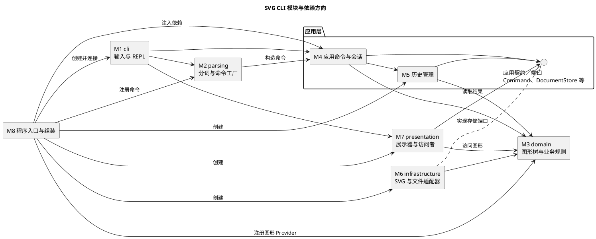

# Lab1 Phase 1：SVG CLI 编辑器——模块架构与测试维护方案

> 文档性质：开发前设计方案，可作为项目 `doc/README.md` 的初稿。
>
> 当前状态：已分析作业附件，代码正在分功能实施，实际进度见 PROGRESS.md；本设计正文保留初始方案用于后续核对。本文中的类、目录、脚本及测试均为拟实施方案，不代表已经完成。
>
> Git 仓库地址：https://github.com/wangjr20210114-hue/svg-cli-lab1
>
> 依据：作业附件 `phase_cli_1.md`。文中明确区分“作业要求”“本方案的设计决定”和“待确认事项”。

## 1. 目标、范围与基本原则

本项目使用 TypeScript 和面向对象方法，实现一个通过逐行命令编辑 SVG 文档的程序。用户操作内存中的图形树，通过 `save` 导出浏览器可以打开的 SVG，通过 `read` 重新读入文件。

### 1.1 本阶段范围

| 类别 | 范围 |
|---|---|
| 文档操作 | `init`、`read`、`save`、`canvas` |
| 图形类型 | `rect`、`circle`、`ellipse`、`line`、`text`、`g` |
| 编辑操作 | `create`、`delete`、`move`、`scale`、`set`、`group`、`ungroup`、`addto`、`front`、`back` |
| 显示操作 | `tree`、`show`、`help` |
| 历史操作 | `undo`、`redo` |
| 通用行为 | `svg>` 提示符、整行注释、双引号参数、唯一且大小写敏感的 ID、统一错误前缀、编辑成功摘要 |
| 阶段外 | `box`、动态插件加载、GUI、鼠标交互、结构路径寻址 |

`create box` 在本阶段应返回题目规定的未知类型错误。预留简单的类型工厂接口，但不提前实现完整插件框架。

### 1.2 架构原则

1. 领域对象封装状态和行为，不以公共字段加自由函数代替对象设计。
2. 一类一文件，文件名与类名一致；下文目录中的省略号代表同类文件，并不表示多类共用一个文件。
3. 命令层通过统一图形接口操作叶子与容器，避免根据图形标签反复分支。
4. 按命令名或图形类型名选择实现，仅存在于命令注册表和图形工厂两处。
5. 所有失败命令均应保持当前文档、历史、当前路径等会话状态不变。
6. 先完成可验证的本阶段实现；扩展点必须有用途，不能只为增加设计模式数量。

## 2. 模块总览、目录与依赖

### 2.1 八个模块及对应模式

| 编号 | 模块 | 核心职责 | 采用的模式或组织方法 | 模式解决的问题 |
|---|---|---|---|---|
| M1 | `cli` 命令行交互 | 读取输入、输出结果、管理 REPL 生命周期 | Adapter（适配器） | 将标准输入输出适配为可替换、可测试的端口 |
| M2 | `parsing` 命令解析 | 分词、语法识别、构造命令 | 命令工厂／注册表 | 将命令名与命令对象的构造集中在唯一位置 |
| M3 | `domain` 图形领域模型 | 图形行为、组合树、ID、结构约束 | Composite（组合）＋图形工厂 | 统一操作容器与叶子，集中图形类型构造 |
| M4 | `application` 应用命令 | 编排编辑、文档操作、查询与历史命令 | Command（命令）＋Template Method（模板方法） | 每条操作一个对象，复用编辑事务流程 |
| M5 | `application/history` 历史管理 | undo/redo、编辑快照、IO 历史屏障 | Memento（备忘录）＋Command 的 Invoker 角色 | 正确恢复整个操作前后状态，集中历史规则 |
| M6 | `infrastructure` SVG 与文件存储 | XML 解析、SVG 编解码、文件读写 | Adapter＋Visitor（访问者，用于写出） | 隔离 IO／XML 细节，避免写出时按标签分支 |
| M7 | `presentation` 结果展示 | `tree`、`show`、成功摘要及错误文本 | Visitor＋Presenter（展示器） | 在不混入终端逻辑的前提下展示不同图形 |
| M8 | 程序入口与组装 | 实例化、注入依赖、注册内置命令与类型 | Composition Root（组合根） | 集中连接对象，避免全局单例与隐式依赖 |

说明：命令工厂是简单工厂／注册表方案，不将其误称为 GoF Factory Method；Presenter、Composition Root 是组织方法。M5 是应用层的独立子模块，不是另一个与应用层互相依赖的顶层业务层。

### 2.2 建议目录

```text
src/
  main.ts
  bootstrap/
    ApplicationBootstrap.ts
  cli/
    CliRepl.ts
    ConsoleInput.ts
    ConsoleOutput.ts
  parsing/
    CommandTokenizer.ts
    CommandParser.ts
    CommandRegistry.ts
    CommandBuilder.ts
  application/
    EditorApplication.ts
    EditorSession.ts
    contracts/
      Command.ts
      UndoableCommand.ts
      CommandResult.ts
    ports/
      DocumentStore.ts
      InputPort.ts
      OutputPort.ts
    commands/
      AbstractEditCommand.ts
      CreateCommand.ts
      MoveCommand.ts
      GroupCommand.ts
      SaveCommand.ts
      TreeCommand.ts
      UndoCommand.ts
      ...
    history/
      HistoryManager.ts
      EditTransaction.ts
  domain/
    SvgDocument.ts
    Shape.ts
    ShapeContainer.ts
    ShapeVisitor.ts
    DocumentMemento.ts
    DomainError.ts
    shapes/
      Rect.ts
      Circle.ts
      Ellipse.ts
      Line.ts
      Text.ts
      Group.ts
    creation/
      ShapeFactory.ts
      ShapeProvider.ts
      RectProvider.ts
      CircleProvider.ts
      ...
  infrastructure/
    svg/
      SvgReader.ts
      SvgWriter.ts
      SvgWriteVisitor.ts
    filesystem/
      FileDocumentStore.ts
  presentation/
    TreePresenter.ts
    TreeLineVisitor.ts
    ShowPresenter.ts
    ShowVisitor.ts
    ResultPresenter.ts
    ErrorPresenter.ts
    HelpPresenter.ts
tests/
  unit/
  integration/
  e2e/
  fixtures/
examples/
  basic.txt
  flowchart.txt
doc/
  README.md
```

端口、访问者等可以使用 TypeScript 接口；接口和不可变结果对象不替代具有行为的领域对象。`DocumentMemento` 放在领域层，由领域对象负责创建、恢复，历史模块只持有它。

### 2.3 允许的依赖方向

| 模块 | 允许依赖 | 禁止依赖／访问 |
|---|---|---|
| M1 `cli` | M2、M4 的公开 API、M7、输入输出端口 | 图形私有状态、真实文件读写实现 |
| M2 `parsing` | M4 的命令及契约 | 文件系统、XML 库、直接编辑文档 |
| M3 `domain` | 本模块及语言基础能力 | 其他业务模块、Node 文件 API、终端、XML 库 |
| M4 应用命令 | M3、M5、应用端口与契约 | M1、M2、M6 的具体类、M7 |
| M5 历史管理 | M3、应用契约 | 具体命令类、文件系统、终端 |
| M6 `infrastructure` | M3、应用存储端口 | 命令解析器、REPL、历史栈 |
| M7 `presentation` | M3 的只读／访问者接口、应用结果契约 | 文档修改、历史修改、文件系统 |
| M8 组装入口 | 上述模块的构造 API | 具体图形编辑算法 |

应用层内部：`commands → history → contracts/domain`；`history` 不反向导入 `commands`。`EditorSession` 只保存当前文档和路径，不导入命令或历史管理器；执行入口连接会话、命令与历史服务。

依赖倒置的具体含义：应用命令只知道 `DocumentStore`，由 M8 注入 `FileDocumentStore`。因此测试应用命令时可以注入内存存储或会失败的存储替身。

### 2.4 PlantUML 模块图

下面的图是方案源码。若 Markdown 平台不渲染 PlantUML，提交时另附由此生成的图，并保留源码以便维护。



## 3. 各模块的构建、测试与维护

### 3.1 M1：命令行交互模块

**边界与职责**：负责提示符、逐行读取、EOF 退出、调用解析与执行入口、交给展示器输出。不解释几何参数，不自行修改文档。输入来源既可以是交互终端，也可以是脚本重放流。

**构建方式：Adapter。** `ConsoleInput`、`ConsoleOutput` 实现应用输入输出端口。`CliRepl` 只依赖端口，因此测试无需真实终端。终端启动提示与脚本模式下的提示符策略集中管理。

**主要协作接口**：读取一行；提交一条命令；输出结果。一次错误只输出一条以 `error:` 开头的信息，随后继续读取下一行。空行与整行注释不执行命令，也不改变历史。

**测试方法**：

- 注入多行内存输入与记录型输出，检查提示符、命令结果和顺序。
- 输入错误命令后继续输入合法命令，确认 REPL 仍可工作。
- 检查空行、注释、EOF 不产生编辑记录。
- 回放包含中文、空格、颜色值和带空格文件路径的脚本。

**维护方法**：增加批处理入口时替换输入适配器，复用解析与应用逻辑；修改终端文案时集中调整展示器。回归 CLI 集成测试和至少一条完整脚本。

### 3.2 M2：命令解析模块

**边界与职责**：把一行文本转换成命令对象；处理双引号、参数数量、可选参数和尾部 `in <containerId>`。只识别语法，不判断目标图形是否存在。

**构建方式：命令工厂／注册表。** `CommandRegistry` 保存“命令名 → CommandBuilder”的唯一映射。具体 Builder 构造命令，避免一个巨型 `switch` 承担所有参数处理。`CommandParser` 不再维护第二份命令名分派表。

**重要规则**：

- Token 保留是否被引号包裹的信息，防止把文本内容中的 `in` 误判为容器子句。
- 只有行首注释按约定跳过；不能把 `#4a90d9` 当成注释截断。
- `create` 的类型参数交给 M3 的图形工厂处理；解析器不再按 `rect/circle/...` 分支。
- 命令名注册信息可以同时提供帮助语法，避免 `help` 与实际解析规则各维护一份。

**测试方法**：建立表驱动用例，覆盖双引号文本、中文、空文本、未闭合引号、颜色、缺参、多参、带空格路径、合法／非法 `in` 子句。检查构造的命令及参数，不依赖实际文件。

**维护方法**：新增命令时增加命令类、Builder、注册信息和对应测试。扫描代码确认命令名分派仍只在 `CommandRegistry` 一处。

**待重构点**：本阶段内置命令注册表符合允许的集中分派；后续若支持动态命令扩展，需重构注册生命周期和帮助元数据，不提前实现插件发现机制。

### 3.3 M3：图形领域模型模块

**边界与职责**：管理图形几何、样式、父子关系、顺序、ID 索引与领域约束。这里是唯一可以真正改变图形状态的模块。

**构建方式：Composite＋图形工厂。**

- `Shape` 定义移动、缩放、属性设置、复制、接受访问者等统一行为。
- 六种具体图形各自实现几何规则和属性白名单；公共样式行为由基类封装。
- `Group` 持有私有子节点序列，递归委托移动与缩放。`ShapeContainer` 表达容器能力，通过多态查询能力，避免外部比较类型字符串。
- `SvgDocument` 封装根级节点、画布尺寸、查找、插入、删除、移动归属和索引一致性。SVG 根是文档边界，不伪装成需要自动编号的普通 `g`。
- `ShapeFactory` 保存“类型名 → ShapeProvider”的唯一映射；每种 Provider 构造相应图形，负责该类型参数的转换与校验。
- CLI 创建和 SVG 导入都复用同一个工厂查找入口。Provider 可以分别接受位置参数和标准化属性输入，但不接受 XML 库的 DOM 对象，领域层不依赖 XML。

**核心不变量**：

1. ID 全文档唯一且大小写敏感；每个可寻址图形只有一个父级。
2. 容器树无环，子节点序列具有稳定顺序。
3. 删除容器必须删除整棵子树在索引中的记录。
4. 非法属性、非法缩放或不合法结构操作不能留下部分修改。
5. 容器与叶子都通过对象方法操作，外部不能直接修改其字段或子节点数组。

**明确的本阶段实现决定**：

- 内部移动、缩放直接更新几何值；容器递归处理子孙，避免同一次操作同时改坐标并叠加 `transform`。
- `scale` 同时缩放位置和尺寸。`stroke-width` 是样式，不作为几何属性自动缩放。
- 普通 `g` 的 `set fill/stroke/stroke-width` 修改容器自身属性，导出后遵循 SVG 继承；不主动覆盖子节点显式样式。该细节作为设计约定记录，必要时向教师确认。
- 根级 `g` 的 `ungroup` 按题目要求拒绝；历史恢复使用内部恢复机制，不受用户命令前置条件限制。

**测试方法**：每种类型分别测试移动、缩放、合法属性和非法属性；用至少三层嵌套验证组合行为。对每次结构修改及恢复检查树可达节点与 ID 索引是否一一对应，并验证没有循环或重复父级。

**维护方法**：新增几何规则只修改对应图形和 Provider；新增图形类型还需实现访问者方法、注册 Provider、增加完整契约测试。本阶段 Visitor 是固定六种类型的接口，新增类型会影响相关访问者；这是本阶段接受的成本，不声称已达到后续插件阶段“内核零修改”的目标。

**待重构点**：图形类型名查找只在 `ShapeFactory`；后续插件化需扩展 Provider 的创建、展示及序列化协议。

### 3.4 M4：应用命令模块

**边界与职责**：把用户意图组织成完整用例，负责校验顺序、调用领域行为、调用存储端口以及产生不可变结果。`EditorSession` 封装当前文档与当前路径。

**构建方式：Command＋Template Method。** 每条命令是一个对象；编辑命令共用 `AbstractEditCommand` 的固定事务步骤，具体命令只实现自己的校验与领域操作。共用流程由编辑事务协调器执行，避免在每个命令中复制快照及历史代码。

| 命令类别 | 实现职责 | 历史行为 |
|---|---|---|
| 编辑 | 创建、删除、移动、缩放、设置、分组、排序等 | 一条成功命令一个单元 |
| 文档 | 新建、读入、保存、修改画布尺寸 | 成功后建立历史屏障 |
| 查询 | `tree/show/help`、无参数 `canvas` | 不入栈，也不改变历史屏障 |
| 历史 | `undo/redo` | 委托 M5，不把自身记成编辑 |

**编辑执行顺序**：验证参数及目标 → 捕获旧状态 → 应用领域操作 → 生成结果 → 捕获新状态 → 提交历史记录。记录历史也属于提交过程；提交之前的异常均恢复旧状态。输出端口故障不重新执行已提交的编辑，避免一条命令生效两次。

**文档操作顺序**：读入时先构造并验证临时文档；全部成功后才替换当前文档。保存时先完成序列化和文件存储，成功后才更新当前路径及历史屏障。失败不能替换当前文档或清空历史。

**测试方法**：每条命令至少覆盖成功路径及一个实际失败路径。使用存储替身模拟不存在、不可读、不可写、解析错误。对复杂命令比较操作前后树结构、顺序及历史，而不是只验证输出文本。

**维护方法**：一个用例的行为集中在对应命令中；共享图形规则下沉到领域层，共享事务规则留在抽象命令／协调器。新增编辑命令必须能通过统一的“执行—撤销—重做—失败不变”契约测试。

### 3.5 M5：历史与事务模块

**边界与职责**：维护 undo 栈、redo 栈和 IO 屏障；协调编辑的提交与恢复。它只面向可撤销命令契约，不知道 `MoveCommand` 或 `GroupCommand` 等具体类。

**构建方式：Memento＋Command Invoker。** `SvgDocument` 创建和恢复 `DocumentMemento`；`HistoryManager` 仅保存命令与备忘录，不读取图形私有字段。`EditTransaction` 负责将领域修改与历史提交作为一个完整操作。

**本阶段采用完整文档快照**：一次成功编辑保存前、后快照，撤销恢复前快照，重做恢复后快照。快照通过多态深复制生成，保留具体类、文本、样式和顺序，不用 JSON 字符串反序列化恢复图形类型，因此不会出现第三处类型名分派。

**快照边界**：包含画布与图形状态；父级引用和 ID 索引在恢复时重新建立。当前文件路径由会话管理，编辑不改变路径。快照不得与活动文档共享可变节点；外部不持有可跨恢复使用的 Shape 引用，命令长期定位目标使用 ID。

| 事件 | undo 栈 | redo 栈 | 屏障 |
|---|---|---|---|
| 成功编辑 | 压入本次记录 | 清空 | 解除 |
| 失败编辑 | 不变 | 不变 | 不变 |
| 成功 undo | 弹出并恢复前状态 | 压入对应记录 | 保持解除 |
| 成功 redo | 压入对应记录 | 弹出并恢复后状态 | 保持解除 |
| 成功文档操作 | 清空 | 清空 | 启用 |
| 失败文档操作 | 不变 | 不变 | 不变 |
| 显示／注释／空行 | 不变 | 不变 | 不变 |

清空旧历史并启用屏障，是本方案对 IO 边界的实现决定。它保证下一次成功编辑解除屏障后，也不能越过该边界撤销旧文档；若教师要求保留更早历史，应相应调整本表与测试。

**测试方法**：连续撤销重做；撤销后新编辑清空 redo；撤销后失败编辑保留 redo；整个 `group` 只需一次 undo；删除容器后恢复完整子树与顺序；IO 后返回 `error: undo not allowed after io command`；查询与失败命令不解除屏障；读入新文件后不能撤回旧文档。

**维护方法**：当前快照空间随“历史条数 × 文档大小”增长，适用于作业规模。若实际性能测试表明有必要，再换成局部快照或增量记录；保持 Command 的公开行为和历史契约不变。任何优化都要重跑全部结构恢复测试。

### 3.6 M6：SVG 编解码与文件存储模块

**边界与职责**：将文件系统、XML 与领域模型连接起来。`FileDocumentStore` 实现存储端口；`SvgReader` 解析输入，`SvgWriter` 和 `SvgWriteVisitor` 生成 SVG。

**构建方式：Adapter＋Visitor。** 文件适配器隔离 Node 文件 API；写出访问者通过 `shape.accept(visitor)` 分派到具体访问方法，不使用 `switch(tag)`。读入时，将 XML 元素标准化后交给唯一的 `ShapeFactory`；组的子节点通过容器能力递归装入。

**读入流程**：

1. 读取并解析 XML，验证根元素与本阶段支持范围。
2. 预扫描所有显式 ID，检查冲突并保留名称。
3. 给缺失 ID 的图形分配“标签名＋序号”，避开所有已占用名称。
4. 通过工厂创建图形，再构造父子关系和索引。
5. 整体验证成功后返回临时文档与警告列表；由命令层一次性提交。

自动补 ID 的警告应在导入成功后输出，避免失败导入时出现看似已经生效的部分警告。显式重复 ID 的导入处理属于题目未完全指定的情形，本方案选择报错并保留旧文档。

**写出流程**：领域树 → XML 结构／文本 → 文件适配器保存。保留节点顺序、文本、ID 与支持的属性；设置 SVG 命名空间与画布信息，正确转义文本及属性值。省略的 `fill/stroke` 保持省略，不人为写入颜色默认值。

为减少写入失败损坏旧文件的风险，拟采用同目录临时文件及平台支持的替换操作；不先删除目标文件再写入。文件保存成功后再更新会话状态。完整文件替换行为需在实际运行平台验证。

**测试方法**：

- 覆盖六种类型、嵌套组、小数、中文、空文本、特殊字符和省略样式。
- 预置显式 `rect1`，再读取无 ID 的矩形，检查补号不会冲突。
- 检查文件错误、非法 XML、重复 ID 均保留旧文档和历史。
- 验证 round-trip：保存后读回，比较结构、顺序与受支持属性，不要求 XML 字节完全相同。
- 浏览器打开导出的流程图，验证几何、文字、颜色和遮挡关系。

**维护方法**：XML 库替换仅影响本模块；使用 XML 解析器，不用正则实现完整 XML 解析。输入文件视为数据，不执行其中内容，不需要外部实体解析或联网资源获取。对未知标签、`transform` 等未确认范围，不静默丢弃后声称完整支持；具体处理见第 6 节。

### 3.7 M7：结果展示模块

**边界与职责**：负责输出文本格式，不负责编辑。查询命令返回只读数据或受控的访问入口，CLI 调用展示器生成文本。

**构建方式：Visitor＋Presenter。** `TreeLineVisitor`、`ShowVisitor` 按具体图形生成几何摘要；`TreePresenter` 负责树枝符号和缩进；`ResultPresenter` 负责成功摘要；`ErrorPresenter` 统一错误前缀。领域模型不调用 `console.log`，应用命令不导入展示器。

**关键约束**：`tree` 必须内联几何属性；`tree <id>` 只输出该子树；`show` 显示父级及属性；颜色、文本和浮点数保持含义。错误文本以题目列出的字符串为准，不能随意改写已明确的错误约定。

**测试方法**：使用固定图形树验证完整输出，覆盖多级树枝、六种类型、父级、颜色与中文。少量稳定输出使用 golden 文件；几何规则通过领域测试验证，避免把所有正确性都寄托在文本快照上。

**维护方法**：新增展示格式只增加展示器；新增图形类型需补全访问者。修改空格、数字格式或文案时审查 golden 差异，确认是有意变化。无意改变的题目错误字符串视为回归。

### 3.8 M8：程序入口与组装模块

**边界与职责**：创建存储、会话、历史、工厂、解析器、展示器与 REPL，注入接口，注册内置命令和图形。

**构建方式：Composition Root。** 在唯一入口完成依赖注入，无需额外 DI 框架，不使用隐藏的全局服务定位器。入口不包含几何、分组、XML 或历史算法。

**测试方法**：从真实入口启动进程，输入最小命令脚本，检查退出、输出和生成文件；再执行一次附件流程图案例。使用独立临时目录，避免读写真实作业文件。

**维护方法**：替换适配器、增加内置命令或类型时修改注册与连接部分。启动入口改动后，运行类型检查、启动冒烟测试和端到端测试。

## 4. 跨模块协议与行为约定

### 4.1 端口与结果

| 契约 | 责任与边界 |
|---|---|
| `Command` | 表达一次用户操作；执行返回不可变结果，不直接打印 |
| `UndoableCommand` | 表达一条编辑的执行与恢复能力；历史模块只依赖此契约 |
| `DocumentStore` | 加载文档、保存文档；不操作历史或终端 |
| `ShapeProvider` | 从创建参数或标准化属性创建对应图形；不读文件 |
| `ShapeVisitor` | 对固定六种类型提供访问方法；接受者负责多态分派 |
| `CommandResult` | 承载操作类别、目标 ID、摘要值、警告或只读查询结果；不承担领域修改 |

上述是职责级契约，具体 TypeScript 签名在实现时确定。结果对象中的类型信息只用于展示和诊断，不作为新的图形行为分派入口。

### 4.2 状态所有权

| 状态 | 所有者 | 其他模块如何使用 |
|---|---|---|
| 当前文档、当前文件路径 | `EditorSession` | 命令通过公开方法读取或替换 |
| 图形字段、子节点、ID 索引 | `SvgDocument` 与图形对象 | 通过行为方法修改，通过只读接口或访问者查看 |
| undo/redo 栈、IO 屏障 | `HistoryManager` | 命令请求操作，外部不直接操作数组 |
| 文档快照内部结构 | `DocumentMemento`／`SvgDocument` | 历史模块持有，领域对象恢复 |
| 命令名注册 | `CommandRegistry` | 入口注册，解析器查找 |
| 图形类型注册 | `ShapeFactory` | 入口注册，创建与导入共用查找 |
| 文件、终端句柄 | 对应适配器 | 核心业务通过端口使用 |

### 4.3 失败原子性

每条失败命令都要检查：文档内容、父子关系、顺序、ID 集合、画布、当前路径、两个历史栈、IO 屏障均与失败前一致。错误不应只靠“没有抛异常”来验证。

快照用于防止多步编辑产生部分提交，但不能替代前置校验。例如 `group` 应先检查全部 ID、重复参数、祖先关系及新 ID，再开始摘取节点。

### 4.4 绘制顺序

SVG 后面的同级元素通常覆盖前面的元素。因此本方案将 `front` 定义为移至同级序列末尾，将 `back` 定义为移至同级序列开头。排序只影响同级，撤销必须恢复原位置。此解释需要在 README 和测试中保持一致。

## 5. 测试、验收与持续维护

### 5.1 三层测试

| 层级 | 验证内容 | 依赖与运行方式 |
|---|---|---|
| 单元测试 | 图形行为、Tokenizer、命令校验、历史状态机、访问者 | 内存对象及必要替身，不依赖真实终端／网络 |
| 集成测试 | 命令到领域树、解析到执行、SVG round-trip、文件失败 | 连接真实模块，文件放入临时目录 |
| 端到端测试 | 真实 CLI 启动、脚本回放、导出与重新读入 | 真实进程、标准输入输出、临时文件 |

浏览器预览作为补充人工验收：它能发现输出的实际显示问题，但不能替代撤销、ID 和失败原子性的自动化测试。

### 5.2 核心验收矩阵

| 编号 | 场景 | 关键断言 | 主要负责模块 |
|---|---|---|---|
| T01 | 创建六种类型，含小数和省略颜色 | 字段、类型、默认属性省略正确 | M2、M3、M4 |
| T02 | 重复 ID、仅大小写不同的 ID | 重复拒绝；大小写不同可共存 | M3、M4 |
| T03 | `create ... in g` | 父级正确、顺序正确；目标错误时状态不变 | M2、M3、M4 |
| T04 | 文本含空格、中文、`in`、颜色值 | 分词准确，文本不被当子句，颜色不被截断 | M1、M2 |
| T05 | 三层组整体移动与缩放 | 所有后代位置和尺寸正确，无重复变换 | M3 |
| T06 | 非正／非有限缩放参数 | 拒绝，文档与历史不变 | M2、M3、M4、M5 |
| T07 | 各类几何属性与样式设置 | 白名单正确；非法属性给出约定错误 | M3、M4 |
| T08 | 删除组后 undo/redo | 子树、父级、ID 索引、同级位置完整恢复 | M3、M4、M5 |
| T09 | 多图形 group，含跨父级 | 一个历史单元；符合已确认的位置与顺序约定 | M3、M4、M5 |
| T10 | 同时 group 容器及后代 | 按题目报错，所有状态不变 | M3、M4 |
| T11 | `addto` 自身／后代 | 不产生循环，错误不提交 | M3、M4 |
| T12 | 合法 ungroup 与根级 ungroup | 子节点占据原位置；根级按题目拒绝 | M3、M4、M5 |
| T13 | front/back 后撤销 | 显示顺序正确，恢复原同级位置 | M3、M4、M5、M6 |
| T14 | 连续 undo/redo | 每次恢复对应状态，空栈行为稳定 | M5 |
| T15 | undo 后成功／失败编辑 | 成功清空 redo；失败保留 redo | M4、M5 |
| T16 | IO 屏障及查询命令 | 成功 IO 禁止 undo/redo；查询不解禁；成功编辑解禁 | M4、M5 |
| T17 | 读取缺 ID 文件且已有 `rect1` | 自动编号避让，成功后输出准确警告 | M3、M6、M7 |
| T18 | 非法 XML、重复 ID、读写失败 | 当前文档、路径与历史均不变 | M4、M5、M6 |
| T19 | 保存并读回嵌套图形 | 结构、顺序、文本和受支持属性语义等价 | M3、M6 |
| T20 | 文本含 `&`、`<` 与属性特殊字符 | SVG 合法，读回文本保持原意 | M6 |
| T21 | tree/show/help 与错误文本 | 几何信息完整，父级准确，固定错误串匹配 | M2、M7 |
| T22 | 无文档时执行需要文档的操作 | 返回题目规定的无文档错误 | M4、M7 |
| T23 | 附件第 6 节及第 6.1 节版本 A | 命令可回放，结果与案例语义一致 | 全部 |
| T24 | 导出流程图的浏览器预览 | 图形、文字、颜色、遮挡顺序符合预期 | M6；人工验收 |
| T25 | `create box` 与其他未知类型 | 按阶段边界返回约定未知类型错误 | M3、M4、M7 |

以上为计划用例，尚未执行。文档提交前应补充测试文件位置、实际命令、日期和结果；不能把计划矩阵写成全部通过。

### 5.3 统一的可撤销命令契约测试

对每种编辑命令复用以下流程：

1. 准备文档并记录结构、顺序、属性、ID 与历史状态。
2. 执行命令，确认只增加一个 undo 单元。
3. undo，确认恢复执行前的完整语义状态。
4. redo，确认恢复第一次执行后的状态。
5. 准备一个真实非法输入，验证失败时完整状态不变。

快照比较通过专用的只读测试访问者生成规范化表示，或通过公开查询验证，不公开领域可变字段。测试不只比较备忘录自身，避免备忘录缺字段时产生同源错误。

### 5.4 修改后的回归范围

| 修改位置 | 最少需要执行的回归 |
|---|---|
| 分词／语法 | 分词用例、命令构造、CLI 脚本回放 |
| 某个图形类／Provider | 对应几何与属性、工厂、快照、展示、SVG round-trip |
| Group／树操作 | 全部结构不变量、嵌套操作、顺序、历史恢复 |
| 历史／事务 | 全部可撤销命令契约、失败原子性、IO 屏障 |
| SVG／文件适配器 | 导入导出、特殊字符、补 ID、文件失败、浏览器预览 |
| 展示器 | 输出 golden、固定错误文本、完整 CLI 案例 |
| 入口／端口／依赖 | 类型检查、架构依赖检查、启动与端到端测试 |

### 5.5 质量门禁与维护惯例

拟配置以下项目脚本，名称在实现时写入 `package.json`，当前不可视为已经可运行：

```text
npm run typecheck       TypeScript 严格类型检查
npm run test:unit       单元测试
npm run test:integration 集成测试
npm run test:e2e        CLI 端到端测试
npm run check:deps      模块依赖与循环检查
npm run cli            启动编辑器
```

启用严格类型检查，提交依赖锁文件；记录实际 Node.js 与包管理器版本。使用一个测试框架覆盖上述层级即可，不为单元和集成测试重复引入多套工具。

`check:deps` 根据第 2.3 节检查导入边界，排除测试替身和入口组装的合法情况；特别检查 domain 不导入 IO、历史不导入具体命令。按名字分派仅有两处这一要求还需代码审查确认，不能仅靠搜索 `switch` 判断。

主分支验收包括类型检查、自动化测试、依赖检查和一次完整脚本。测试失败时先定位受影响模块和契约；修复可重复出现的行为缺陷时补充回归用例。通过后如无新修改或疑点，不重复扩大无关测试。

维护代码时同步更新三处：相关测试、架构／语义决定、必要的使用示例。引入新模式前应说明它解决的实际变化点。

## 6. 题目未完全指定的语义与处理建议

以下不是额外的作业硬性要求。它们是开发时需要明确的契约，不应在实现中悄悄自行解释。

| 事项 | 本方案建议 | 确认后影响 |
|---|---|---|
| 跨父级 group 的新父级与插入位置 | 新组放在所选节点父级的最近公共祖先中，位于最早受影响分支之前；选中节点按操作前文档遍历顺序收入 | 树操作、z-order、undo、T09 |
| “保持相对顺序”指参数顺序还是原文档顺序 | 采用原文档遍历顺序；README 明示 | group 实现与验收 |
| 普通 g 的 set 样式 | 设置 g 自身，让 SVG 继承生效；不覆盖子图形显式样式 | 领域属性、保存与预览 |
| 外部 SVG 的 transform、未知标签及额外属性 | 明确支持子集；不能静默忽略 transform 导致图形位置错误。若要求支持，应增加归一化或保留方案；确认前对不能正确处理的输入明确报错，保留当前文档 | SvgReader、领域坐标策略、round-trip |
| 文档操作后的旧历史 | 清空两个栈并启用屏障；下一次成功编辑只开始新历史 | M5 与 T16 |
| 负宽高、负半径、非有限数值 | 非有限数值拒绝；建议宽高与半径不为负、画布尺寸为正；最终错误文案需约定 | Provider、属性设置、数值测试 |
| 仅给一个尺寸参数、空历史栈、未初始化时 help | 补全确定的语法／文案约定；建议 help 可随时使用。若与评分规则冲突，以教师确认规则为准 | Parser、历史、CLI |
| 导入文件含重复显式 ID | 拒绝导入并保留旧文档，不自行重命名已有 ID | M6、T18 |

上述疑点不阻止开发已经明确的图形模型、标准命令和测试基础，但相关验收用例应在约定确定后固定下来。

## 7. 变化点假设与扩展取舍

| 未来变化 | 现在保留什么 | 现在不做什么及理由 |
|---|---|---|
| CLI 之外增加 agent／GUI | 应用命令、领域行为与输入输出解耦 | 不提前开发 GUI 或远程协议 |
| 增加 box 或其他图形 | 单一 ShapeFactory、Provider、组合树 | 不实现插件加载；固定 Visitor 后续需演进 |
| 更换 XML 库／存储介质 | DocumentStore 端口、独立编解码适配器 | 不同时支持多种文件格式，避免无用抽象 |
| 更改 tree/show 风格 | 独立 Presenter 与访问者 | 不做主题引擎或复杂模板系统 |
| 大文档与较长历史 | 独立备忘录、历史和事务模块 | 不先实现增量历史、磁盘缓存或快照压缩，等待性能证据 |
| 新增命令或语法 | 命令 Builder 与注册表 | 不实现通用脚本语言或插件发现系统 |

## 8. 开发与 Git 推进计划

| 里程碑 | 完成内容 | 检查点 |
|---|---|---|
| P1 | 初始化工程、架构草案、输入输出端口 | 能启动 CLI；文档注明未决语义 |
| P2 | 图形类、容器、工厂、ID 与树不变量 | 图形与组合单元测试通过 |
| P3 | 分词、基础命令、tree/show | 可创建、移动、查询图形 |
| P4 | Command、快照、历史、事务 | 可撤销契约与失败原子性通过 |
| P5 | group/ungroup/addto/front/back | 嵌套、顺序、恢复通过 |
| P6 | SVG 读写、补 ID、IO 屏障 | round-trip、文件失败及预览通过 |
| P7 | 全案例回放、依赖自查、文档修订 | 形成可复现的最终验证记录 |

每个里程碑允许按真实工作拆成多个提交。提交应反映当时已经完成的增量，不在最后伪造开发历史。

最终在验收通过的提交上创建并推送 `final` 标签，且在截止时间前完成。代码及文档均推送远程；课程平台提交包含真实仓库地址的 README。仓库正文放在 `doc/README.md`，根目录可放简短导航。

## 9. 过程记录与修订记录

### 9.1 当前实际记录

| 阶段 | 已发生的工作 | 得到的结论 |
|---|---|---|
| 需求分析 | 已阅读用户提供的 `phase_cli_1.md` | 本阶段包含六种类型；box 与插件化不在本阶段实现范围 |
| 架构草案 | 按用户要求形成本文 | 明确八个模块、依赖方向、模式、测试与维护边界 |
| 实现与验证 | 尚未开始 | 不声明任何测试已经通过，也不声明已有 final 标签 |

### 9.2 后续记录格式

每次有代表性的讨论或修正记录：问题／AI 建议 → 如何检查 → 最终决定 → 涉及的代码与测试 → 对应 Git 提交。只记录真实发生的过程，不用模板例子冒充事实。

架构变更记录至少包含：原方案、修改原因、实际实现、依赖变化、验证结果。尤其记录快照策略、跨父级分组语义与 SVG 导入范围的最终决定。

## 10. 一致性自查与最终质量记录

当前仅能自查设计内部一致性；下面的实现检查必须在编码完成后如实填写。

- [ ] 实际模块与第 2 节一致；偏差已记录。
- [ ] 每个类单独成文件，图形状态具有封装与行为。
- [ ] Command 与 Composite 在代码中实际使用。
- [ ] 命令名与图形类型名分派分别只在一个集中入口，并标注待重构点。
- [ ] domain 无 IO／XML 依赖，history 无具体命令反向依赖。
- [ ] 所有编辑命令满足一条命令一个历史单元。
- [ ] 失败编辑、失败读写不改变会话状态与历史。
- [ ] 导入、导出、特殊字符、补 ID 与顺序均有验证。
- [ ] 本阶段明确拒绝 box，不将后续插件目标冒充已实现功能。
- [ ] T01—T25 已填写真实结果，相关未决语义已固定或标明限制。
- [ ] README 记录实际环境、启动方法、测试命令和验证日期。
- [ ] 真实 Git 仓库地址已填写，增量提交已推送。
- [ ] final 标签指向已验收版本，且标签已在截止时间前推送。

最终质量记录建议填写：验证日期、Git 提交号、实际执行命令、通过／失败结果、人工 SVG 预览结果、已知限制。未执行的检查应明确标为“未执行”，不能以计划替代证据。
