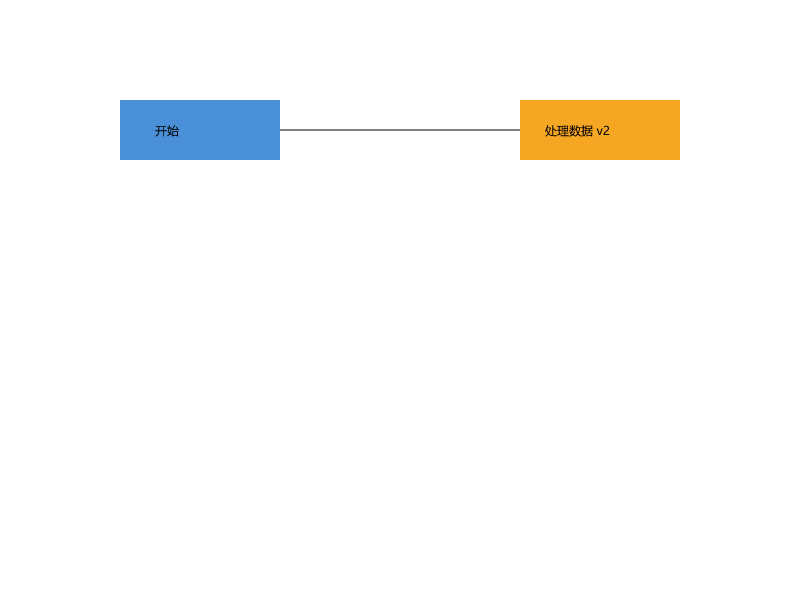
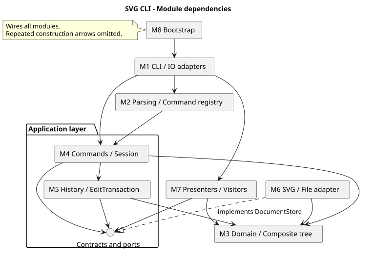

# Lab1 Phase 1：SVG 命令行编辑器

Git 仓库地址：**https://github.com/wangjr20210114-hue/svg-cli-lab1**

本项目以 TypeScript 面向对象方式实现 Phase 1 的六种图形和 19 条命令，使用 Command、Composite、Memento 与 Visitor。源码按功能分步提交并推送，最终版本以 `final` 标签标识。

本文是提交文档，包含实际架构、真实过程、一致性自查与质量保证。[DESIGN.md](DESIGN.md) 保留开发前的详细模块方案；[PROGRESS.md](PROGRESS.md) 记录分功能推进。历史方案中的“计划”不能替代本文的实际验证结果。

## 1. 安装、运行与复现测试

需要 Node.js 22 或更高版本及 npm；已在 Linux/Node 22、Windows/Node 24 的 GitHub CI 验证。依赖锁定在 `package-lock.json`，新环境优先使用 `npm ci`。

```sh
git clone https://github.com/wangjr20210114-hue/svg-cli-lab1.git
cd svg-cli-lab1
npm ci
npm run verify
npm run cli
```

Windows PowerShell 中也可使用 `npm.cmd ci`、`npm.cmd run verify` 等命令。程序显示 `svg>` 后逐行输入，EOF 结束：Windows 为 Ctrl+Z 后 Enter，macOS/Linux 为 Ctrl+D。

### 1.1 一键演示与预期结果

```sh
npm run demo
```

回放附件第 6.1 节版本 A，生成工程根目录的 `flowchart.svg`。浏览器打开文件，应显示两个彩色矩形及中文文字，中间用黑线连接。移动 node2 后已撤销，所以第二个矩形仍在 y=100；文字已改成“处理数据 v2”。SVG 内共 8 个图形元素，含 3 个组。



```sh
npm run demo:basic
```

回放附件第 6 节主会话，生成 `demo.svg`，再读入 `tests/fixtures/other.svg`。该案例有两条**预期错误**：祖先与后代同时分组、保存后撤销；最后输出 400×300 文档并给无 ID 矩形补为 rect1。测试会确认仅出现这两条错误。

### 1.2 手动检查核心操作

```text
init 800 600
create g scene
create rect r1 10 20 100 50 #4a90d9 in scene
create text t1 20 50 "Hello 中文" in scene
tree
move scene 100 0
show r1
undo
show r1
redo
save manual.svg
undo
```

两次 show 的 x 分别为 110、10；redo 恢复 x=110。save 成功后 undo 返回 `error: undo not allowed after io command`。浏览器打开 manual.svg 检查矩形与文字。执行新的成功编辑后才能重新 undo/redo。

## 2. 架构方案与实际模块

### 2.1 目录与模块边界

```text
src/
  main.ts                    入口
  bootstrap/                 M8 对象组装与内置注册
  cli/                       M1 REPL、标准输入输出适配器
  parsing/                   M2 分词、参数、唯一命令注册表
  domain/                    M3 文档、图形、组合树与工厂
    shapes/                  六种图形
    creation/                唯一图形工厂及六个 Provider
  application/               M4 应用入口、会话、命令
    contracts/               命令、结果、DocumentAccess 等契约
    ports/                   输入、输出、存储端口
    commands/                每条命令对应的类
    history/                 M5 历史与编辑事务
  infrastructure/            M6 XML/SVG 与文件系统适配器
  presentation/              M7 树、属性、帮助与结果展示
tests/{unit,integration,e2e,fixtures,support}/
scripts/                     验收与案例回放工具
examples/                    附件案例的命令脚本
doc/                         架构、过程与验证文档
```



图的可编辑源码：[architecture.puml](architecture.puml)。箭头表示主要源码依赖；Domain 不依赖上层。M8 负责构造全部模块，图中省略重复的组装箭头。应用契约与端口包含 DocumentStore、DocumentAccess、Command 等不同接口，文件适配器只实现存储接口。

### 2.2 每个模块的功能集合、设计模式、测试与维护

| 模块 | 功能集合与实际主要类 | 模式及落地 | 测试位置与关注点 | 修改后的维护／回归范围 |
|---|---|---|---|---|
| M1 CLI | 输入流、提示符、错误后继续、EOF；CliRepl、ConsoleInput、ConsoleOutput | Adapter：标准流实现 InputPort/OutputPort，REPL 不编辑图形 | e2e/Cli.test.ts：真实进程、中文、脚本、错误恢复 | 新入口替换端口；回归全部脚本与端到端测试 |
| M2 Parsing | 引号分词、参数数量／数值、in 子句、命令构造；CommandTokenizer、CommandArguments、CommandParser、CommandRegistry、CommandBuilder | 简单命令工厂／注册表：唯一命令名查找表；Builder 封装构造 | unit/Tokenizer.test.ts、e2e/Cli.test.ts：空文本、颜色、Windows 路径、引号中的 in | 新命令增加 Builder 注册和契约测试；帮助语法复用注册信息 |
| M3 Domain | 几何、样式、ID、树、顺序、深复制；Shape、GeometryShape、六种图形、SvgDocument、ShapeFactory、Provider | Composite：Group 递归委托；图形工厂：唯一类型名查找入口 | unit/Shapes.test.ts、Document.test.ts、integration/Structure.test.ts：三层嵌套、索引、循环、顺序 | 修改图形回归几何、工厂、历史、展示和 round-trip；新增类型补全 Visitor |
| M4 Application | 创建／编辑／查询／文档命令与会话；各 Command、EditorSession、EditorApplication | Command：每次操作为对象；Template Method：AbstractEditCommand 固定编辑流程 | integration/EditCommands.test.ts、DocumentCommands.test.ts：用例行为、文件失败、路径、历史边界 | 新编辑命令继承共同事务模板；规则下沉领域层，IO 只走存储端口 |
| M5 History | 事务、双栈、IO 屏障；HistoryManager、EditTransaction、DocumentMemento | Memento＋Command Invoker：保存前后文档快照，历史只面向契约 | unit/History.test.ts、integration/Atomicity.test.ts：连续恢复、redo 清空、部分失败回滚 | 改快照／历史必须回归所有可撤销与结构操作；有性能证据后再做增量快照 |
| M6 Infrastructure | XML 读入、补 ID、SVG 写出、文件保存；SvgReader、SvgWriter、SvgWriteVisitor、FileDocumentStore | Adapter：隔离文件与 XML；Visitor：多态写出六种类型 | integration/Svg.test.ts：六类往返、转义、ID 避让、临时文件清理、覆盖保存 | 替换 XML 库影响此模块；回归 round-trip、文件失败及实际预览 |
| M7 Presentation | tree/show/help、成功和错误文本；TreePresenter、TreeLineVisitor、ShowPresenter、ShowVisitor、HelpPresenter、ResultPresenter、ErrorPresenter | Visitor＋Presenter：图形按 accept 分派，展示与修改分离 | unit/Presentation.test.ts、e2e/Cli.test.ts：树枝、内联几何、父级、固定错误串 | 文案修改审查输出差异；新增图形补展示访问者；不引入图形修改 |
| M8 Bootstrap | 创建对象、注入依赖、注册内置能力；ApplicationBootstrap、BuiltinCommands、BuiltinShapes | Composition Root：集中组装，无全局服务定位器 | e2e/Cli.test.ts：从真实 main.ts 启动并回放附件 | 换适配器或注册能力在此连接；入口修改回归启动与全流程 |

详细的模块内部职责、接口及维护策略见历史设计方案第 3 节。Factory 在这里指简单工厂方案；Presenter、Composition Root 是组织方式，不将它们冒称为 GoF 模式。

### 2.3 Command 与撤销的实际流程

编辑命令 execute → HistoryManager.execute → EditTransaction 捕获前状态 → 具体命令调用领域行为 → 校验树不变量 → 捕获后状态 → 入 undo 栈并清空 redo。

操作中异常则恢复前状态，不改变历史；例如组内第二个图形发生数值溢出，第一个图形的修改也会回滚。undo/redo 恢复前／后状态；父级和 ID 索引重新建立。命令长期保留目标 ID，避免在快照恢复后继续使用旧图形引用。

文档操作成功后清空双栈并启用屏障；失败不改变当前文档、路径与历史。canvas 无参数只查询，不产生屏障。显示命令、注释和空行不入栈。成功摘要采用“undone/redone: 原操作摘要”的统一恢复反馈。

### 2.4 依赖方向规则

| 模块 | 允许依赖 |
|---|---|
| domain | domain 内部与语言基础能力 |
| application/contracts、ports | 领域对象及同层契约 |
| application/history | domain、contracts、history 内部；通过 DocumentAccess 读取当前文档 |
| application 其他部分 | domain、contracts、ports、history、application 内部 |
| parsing | parsing、application/contracts |
| presentation | domain、application/contracts、presentation 内部 |
| infrastructure | domain、application/contracts/ports、基础设施内部及 XML／文件库 |
| cli | parsing、application 公共入口及契约、ports、presentation、终端适配能力 |
| bootstrap / main | bootstrap 可连接各模块；main 只调用组装入口 |

自动检查脚本验证导入边界、运行时无循环、一类一文件、文件名与类名一致、业务源码无顶层过程函数。类型接口之间的必要互相引用不当成运行时循环。

按名字分派只有 CommandRegistry 的命令名表、ShapeFactory 的图形类型表。其余编辑、递归和序列化使用多态；格式校验与属性白名单的判断不承担图形类型分派。

**待重构点**：上述两个注册入口当前注册内置实现。进入后续插件阶段时，需演进注册生命周期、类型 schema、展示／序列化扩展协议。本阶段固定六类 Visitor 的新增类型成本被明确接受，未声称已实现“插件增加类型而内核零修改”。

### 2.5 变化点假设与取舍

| 变化点 | 当前准备 | 暂不实现的部分 |
|---|---|---|
| GUI／agent 替代 CLI | 核心命令与输入输出解耦 | GUI、鼠标、网络协议 |
| 增加 box 或其他形状 | 唯一工厂、Provider、Composite | 动态插件加载与 box 语义 |
| 替换 XML 库或存储 | DocumentStore 端口、独立适配器 | 多种存储或文件格式 |
| 更改展示 | Presenter 与 Visitor | 主题／模板引擎 |
| 大文档与长历史 | 独立快照和事务模块 | 增量历史、压缩；目前空间约为历史条数×文档大小 |
| 扩展命令 | Builder 注册与统一帮助元数据 | 通用脚本语言 |

## 3. 过程记录与修订

提交历史直接保留真实开发步骤，每项 feat 实现并验证后推送。没有回填或伪造一次性开发历史。

| 功能 | 实现结果 | 提交 |
|---|---|---|
| F01 | 工程、严格类型、初始架构 | bc8416e |
| F02 | 六种图形与组合几何 | 2d0b2f8 |
| F03 | 文档树、ID、备忘录 | aa073d3 |
| F04 | 引号、颜色、in 解析 | 65765be |
| F05 | Command 事务、撤销重做、IO 屏障 | 33853d4 |
| F06 | 工厂与基础编辑命令 | f81f565 |
| F07 | 分组、归属与层级顺序 | 970f6fc |
| F08 | 访问者与展示 | 7783a04 |
| F09 | SVG 往返与文件替换 | 513370b |
| F10 | 文档命令 | 013aad2 |
| F11 | 完整 CLI、帮助与附件脚本 | 8cae6da |
| 修订 | 历史事务改为依赖 DocumentAccess 接口 | eee16f0 |
| F12 | 架构检查、39 项验收与跨平台 CI | 45a1405 |

代表性讨论和确认过程：

1. 分析附件后确认 box 是后续阶段目标，Phase 1 对其明确报未知类型，避免混淆范围。
2. 容器编辑采用 Composite；scale 同时缩放位置和尺寸，保留样式属性。使用嵌套与各类型测试确认。
3. 为复杂树操作选择完整文档 Memento；加入“修改到一半后失败”的测试，验证快照并非只处理成功路径。
4. Windows 沙箱下覆盖文件发生 EPERM。保留原始异常 cause 后定位到 rename，原测试在普通环境通过；保留临时文件替换策略，不采用先删除旧文件的退化方案。Windows CI 也通过实际文件测试。
5. 审查发现 EditTransaction 引用具体 EditorSession，与设计边界不符；增加 DocumentAccess 最小接口，独立 fix 提交并通过类型与架构检查。
6. 原方案里只有概念上的验证入口；实际增加 ArchitectureCheck 和 ReplayExample 工具，提供可重复验收，而不是只写“已测试”。

实际目录相对初始方案增加 BuiltinShapes、BuiltinCommands、DocumentAccess、LoadedDocument、NumberValue、GeometryShape 以及验收工具。它们分别承担组装、契约与共享几何职责；八个模块的边界保持一致。

## 4. 一致性自查

| 检查项 | 实际结果 |
|---|---|
| 模块划分 | 八个模块均有对应目录；新增辅助类及脚本已记录 |
| 面向对象 | 图形状态为私有，几何、属性、复制和组合操作封装在类中；一类一文件检查通过 |
| Command | 编辑命令继承共同事务模板，每条成功命令形成一个历史单元 |
| Composite | Group 与叶子实现统一 Shape 行为；移动、缩放递归委托 |
| 依赖方向 | 78 个源文件的导入边界与运行时无循环检查通过；历史的具体会话依赖已修复 |
| 分派位置 | 命令名与类型名查找分别集中在两个注册入口；人工审查无散落的按标签编辑分支 |
| 失败原子性 | 参数错误、循环归属、部分数值溢出、读写失败均有回归验证 |
| 阶段边界 | 六种类型；box 明确拒绝；未实现插件框架 |

## 5. 质量保证与真实验证结果

验证日期：2026-10-30（Asia/Shanghai）。本地 Node.js 24.19.0、npm 11.17.0。自动验收命令：

```sh
npm run verify
```

实际结果：编译通过；架构检查通过；**39/39 测试通过**，其中单元 20、集成 14、端到端 5。详细结果与场景映射见 [VALIDATION.md](VALIDATION.md)。

跨平台 CI：[运行记录](https://github.com/wangjr20210114-hue/svg-cli-lab1/actions/runs/41002837466)，验证提交 `45a1405`。GitHub Actions 配置会在后续 push、PR 和手动触发时重复执行相同验收。

维护时可分别执行 `npm run test:unit`、`npm run test:integration`、`npm run test:e2e`、`npm run check:deps`。修改领域／历史时回归全部结构与撤销测试；只修改展示时重点检查输出和端到端案例。依赖使用 lockfile 固定，版本变更应重新验收。

### 5.1 已明确的实现约定与限制

- group 至少收入两个不同图形；按原文档遍历顺序保持相对顺序。跨父级分组放在最近公共祖先中、最早受影响分支之前。
- front 移到同级末尾，即 SVG 视觉前景；back 移到同级开头。根级 g 不能 ungroup，按题目要求执行。
- 普通 g 的样式保留在 g 上，遵循 SVG 继承，不覆盖子节点的显式样式。
- init 允许 0/1/2 个尺寸参数，单独给宽时高为 600；canvas 只允许无参或同时给宽高。画布尺寸为正，图形尺寸和半径不为负；非有限数值拒绝。
- help 可在初始化前使用；空 undo/redo 栈给出明确错误。成功 IO 建立历史屏障，之后的成功编辑开始新历史。
- SVG 导入支持本阶段六类元素、规定的几何／样式属性和纯文本内容。支持数字像素尺寸及与画布匹配的 `0 0 width height` viewBox；不声称支持任意 SVG。transform、path、复杂文本、额外属性及不匹配 viewBox 明确报错，不静默改变图形。显式重复 ID 拒绝，缺 ID 自动补并在成功导入后警告。
- 所有题目主会话与第 6.1 节版本 A 均有真实 CLI 测试；上述未指定细节是本项目记录的实现决定。若课程后续澄清语义，应同步修改代码、测试和文档。

## 6. 提交方式

仓库内正式文档为 `doc/README.md`。课程平台提交本文件；检查开头的仓库链接可访问。最终源码定位使用仓库 `final` 标签；Git 历史保留分功能 feat 与真实 fix。

课程截止时间未在已提供的信息中明确，应以课程平台为准。标签创建与推送的实际时间由远程 Git 记录核对。
